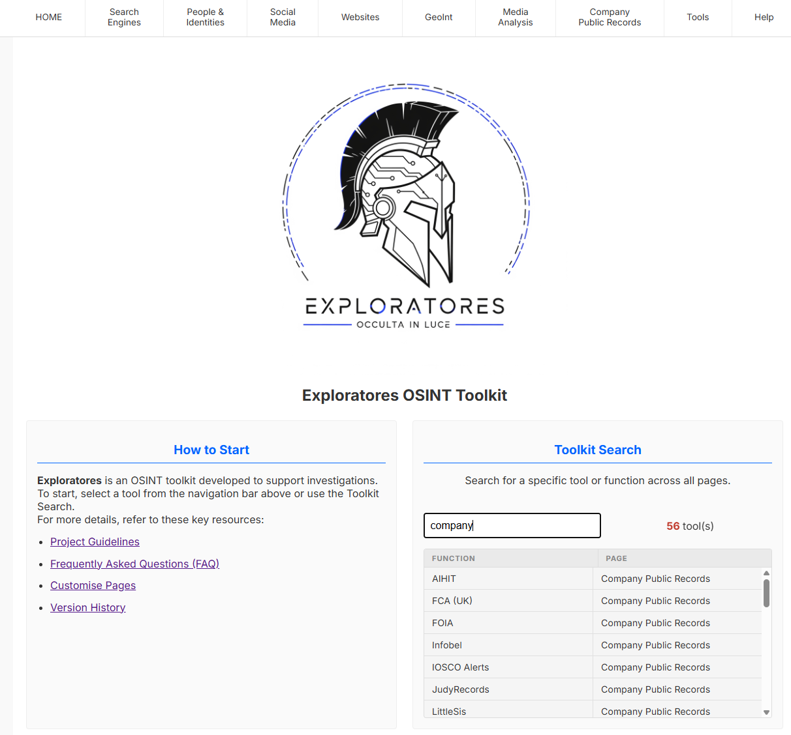
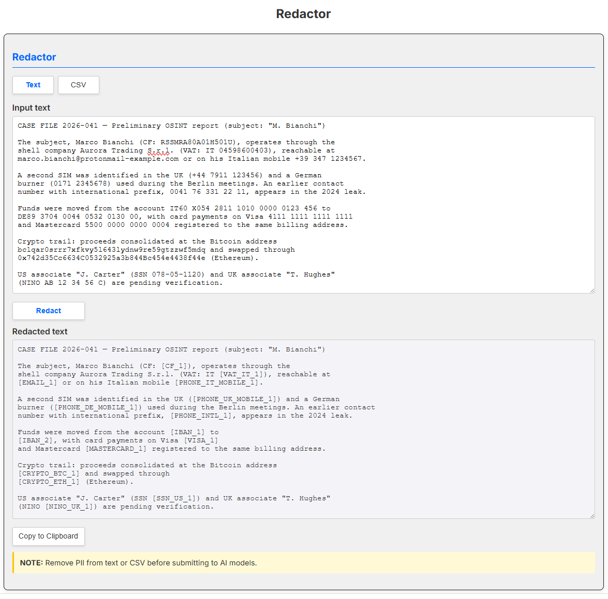

# Exploratores OSINT Toolkit 3.9.0


[TEST ME](https://sosintops.github.io/Exploratores/)


**Exploratores** is a modular and responsive OSINT toolkit designed to support investigative workflows: curated search tools for people, domains, images, social platforms and more, plus built-in utilities such as the Redactor (browser-side PII removal), multi-country IBAN analysis and an embedded CyberChef.

Version 3.9.0 adds SanctionsKit to Public Company Records, next to OpenSanctions, for officers and companies: each record shows its source dates and links to the publisher, with a dated version to cite. Version 3.8.3 corrects the guidelines (ICD 203 wording, the likelihood table labelled, texts linked at first mention) and extends the FAQ and the related projects. Version 3.8.2 aligned the analysis guidelines and the FAQ with the [Intelligence Field Notes](https://github.com/SOsintOps/intelligence-field-notes) (source evaluation, report writing, linked reading list, related projects). Version 3.8.1 removed Italgiure ahead of its shutdown, after 3.8.0, which opens the country-sources programme with Italy: eleven national registries and lookups (civil records, doctors' register, Official Gazette, reverse phone lookup, business register, VAT check, certified e-mail and public-administration indexes, open data, cadastral geoportal, .it WHOIS) added to the thematic pages, each verified in a browser. Next: European countries, Russia, China and the Middle East — see the [roadmap](docs/todo.md). See the full [version history](docs/versionhistory.md) for previous releases.

---

## Key Features

- Fully responsive layout built with semantic HTML5.
- No server or backend dependencies required.
- Centralised JavaScript architecture.
- Modular pages with scoped focus (Names, Phones, Domains, IBAN, etc.).
- Multi-country IBAN verifier with offline bank name resolution for 11 countries.
- Redactor: browser-side PII removal and restoration with numbered placeholders, exportable Redaction Map, CSV support and user-defined custom patterns — designed for safely submitting case text to external AI models.
- Privacy by design: the Redactor, the IBAN tool and CyberChef run entirely in your browser — no data ever leaves your machine.
- Embedded CyberChef (v11.2.0) for local data conversion, decoding and analysis.
- Weekly link health check with automatic flagging of tools on dead hosts, and optional (off by default) catalogue updates for offline copies, verified by SHA-256.

---

## Screenshots

The home page, with the navigation bar and the cross-page Toolkit Search:



The Redactor replacing PII with numbered placeholders before text is submitted to an external AI model:



---

## Requirements

- Any modern web browser (Chrome, Edge, Brave).
- No server or backend required to run the toolkit.
- **Internet access is mandatory** for the external search features to work.
- The use of a VPN is recommended while conducting investigations, to protect your identity and location.

## Installation

1. Clone or download the repository.
   ```bash
   git clone https://github.com/SOsintOps/Exploratores.git
   ```
2. Open **`launchme.html`** in your browser.

## Toolkit Sections

The toolkit is organised into the following sections, accessible from the main navigation menu:

* **Search Engines**: Clear Web and Tor search capabilities.
* **People & Identities**: Tools for investigating names, phone numbers, addresses, and more.
* **Social Media**: Search functions for major platforms (X/Twitter, Facebook, Instagram, LinkedIn, VK, Telegram).
* **Websites**: Tools for domain and IP address analysis.
* **GeoInt**: Mapping and geolocation tools.
* **Media Analysis**: Image, video, and document analysis tools.
* **Company & Finance**: Corporate records, virtual currencies, IBAN verification.
* **Tools**: CyberChef, Redactor (browser-side PII removal and restoration).
* **Help**: Guidelines, FAQ, Customise, Settings, Version History.

---

## Documentation

Detailed documentation is available directly in the toolkit under the **Help** menu:

* [Guidelines](docs/guidelines.md): analytic standards, source evaluation (UNODC 4 x 4), 5W1H method, working with Exploratores, OPSEC best practices, report writing, further reading.
* [FAQ](docs/faq.md): frequently asked questions, architecture overview, troubleshooting.
* [Customise](docs/customise.md): guide to extending and customising the toolkit.
* [Version History](docs/versionhistory.md): full changelog.
* [Ideas & Roadmap](docs/todo.md): ideas and sources under consideration for future implementation.

The `docs/` directory contains the Markdown source for [Guidelines](docs/guidelines.md), [FAQ](docs/faq.md), and [Customise](docs/customise.md).

---

## Link Health

The external tools in the catalogue are checked automatically once a week by a GitHub Actions workflow (Sunday 13:13 UTC). A host is flagged as dead or unreliable only after failing two checks at least a week apart, so temporary outages do not raise false alarms. Findings are published in the open [Weekly link-check report](https://github.com/SOsintOps/Exploratores/issues) issue (label `dead-links`), and cumulative statistics in CSV form are attached to every run as a build artifact. Tools on confirmed-dead hosts are marked as disabled through an automated pull request (merged by a maintainer): they appear greyed out on the page and are hidden from the Toolkit Search until the host recovers or the entry is replaced. The checker lives in `scripts/linkcheck/` and can also be run locally with Node.js — see the [FAQ](docs/faq.md) for details.

---

## How to Use Exploratores

1. Open **`launchme.html`** in a web browser.
2. Navigate to a specific section via the navigation bar.
3. Enter your search terms in the input fields and click the search buttons.
4. Some tools may require you to be logged into the respective service.
5. Always apply OPSEC principles while conducting investigations.

---

## References

- Community feedback from OSINT & Cybercrime analysts
- *Deep Dive: Exploring the Real-World Value of Open Source Intelligence* by Rae L. Baker — [Wiley](https://www.wiley.com/en-us/Deep+Dive%3A+Exploring+the+Real+world+Value+of+Open+Source+Intelligence-p-9781119933243) | [Amazon](https://www.amazon.com/dp/1119933242)
- *ICD 203: Analytic Standards* — [free PDF (ODNI)](https://www.dni.gov/files/documents/ICD/ICD-203.pdf)
- *OSINT Techniques* (11th edition, formerly *Open Source Intelligence Techniques*) by Michael Bazzell and Jason Edison — [IntelTechniques](https://inteltechniques.com/book1.html)
- *Psychology of Intelligence Analysis* by Richards J. Heuer Jr. — [free PDF (CIA CSI)](https://www.cia.gov/resources/csi/static/Pyschology-of-Intelligence-Analysis.pdf)
- *Criminal Intelligence: Manual for Analysts* by Howard Atkin — [free PDF (UNODC)](https://www.unodc.org/documents/organized-crime/Law-Enforcement/Criminal_Intelligence_for_Analysts.pdf)
- [Intelligence Field Notes](https://github.com/SOsintOps/intelligence-field-notes) — our notes on analytic standards, OSINT method, source evaluation and report writing (offline copy in [`docs/field-notes`](docs/field-notes/README.md)); the toolkit's [guidelines](docs/guidelines.md) apply them to Exploratores

---

## Related Projects

- [Argos](https://github.com/SOsintOps/Argos) — an OSINT workstation for Ubuntu Budgie 24.04 or 26.04 LTS: tools, launchers, case folders with hashes, and report templates; Exploratores is its Firefox home page
- [Speculator](https://github.com/SOsintOps/Speculator-Project) — the sister workstation for Debian 13, with the same templates; Exploratores is its start page too
- [Wukong](https://github.com/SOsintOps/Wukong) — the China-focused spin-off of Speculator, for the Chinese-language internet and Chinese companies
- [Claudii Exploratores](https://github.com/SOsintOps/claudii-exploratores) — a direct derivative of Exploratores: its catalogue of OSINT tools as an agent skill and an MCP server for Claude, which classifies an indicator and builds the matching search links (alpha)
- [Quaesitor](https://github.com/SOsintOps/quaesitor) — a local case graph for people, phones, accounts, companies and documents, with the UNODC link-analysis method
- [Elementary CTI](https://github.com/SOsintOps/elementary-CTI) — a ransomware threat-intelligence aggregator
- [Aethelburg](https://github.com/SOsintOps/Aethelburg-project) — an analyser of UK Companies House data for shell companies
- [TelEgrapherX](https://github.com/SOsintOps/TelEgrapherX) — a Telegram collection tool (fork of Telegram Explorer), to go with the Telegram page
- [TGchat-analytics](https://github.com/SOsintOps/TGchat-analytics) — a fork of chat-analytics for statistical reports on exported Telegram chats
- [Maigret](https://github.com/SOsintOps/maigret) — our fork of soxoj's username-search tool, with a web interface, to go with the Usernames page
- [Acta Diurna](https://github.com/SOsintOps/acta-diurna) — a dashboard (in Italian) for news on Italian law-enforcement operations
- [Il Conclave](https://github.com/SOsintOps/il-conclave) — a Claude Code skill (in Italian) that runs a question through forced analytic procedures such as ACH and a premortem
- [Codex Machinae](https://github.com/SOsintOps/codex-machinae) — a modular playbook for building software with LLM collaborators, with a classification module for intelligence tooling

---

## Contributing

Contributions are welcome. To report a bug or propose an enhancement, open an issue on the GitHub repository; pull requests are appreciated — please keep changes consistent with the existing architecture (vanilla JavaScript, no build step, no inline scripts).

---

## Credits

Project developed and maintained by Ramingo.

---

## Licence

This project is released under the [GNU Affero General Public License v3.0](LICENSE) (AGPL-3.0). Bundled third-party software (CyberChef, Inter and Cinzel fonts, libphonenumber, ibankit) remains under its respective licences — see the [licence page](pages/license.html) for details.

---

## Disclaimer

Exploratores is intended for lawful investigations, research and educational use only. Users are solely responsible for ensuring that their use of the toolkit and of the linked external services complies with the laws and regulations of their jurisdiction and with the terms of service of each platform.
